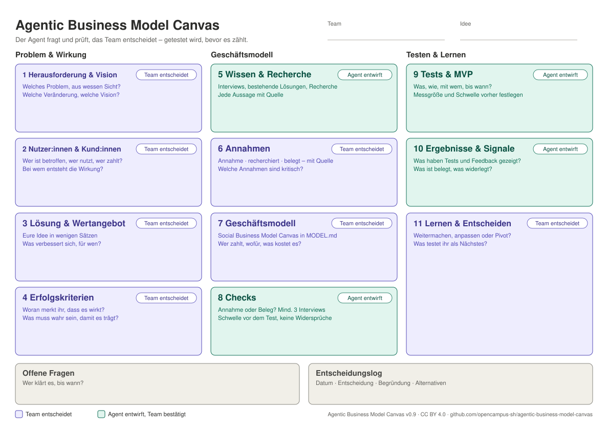

# Agentic Business Model Canvas

{{One sentence: a canvas, a process and a set of agent skills for <work>, with a coding agent, without handing over the judgement.}}

> Status: **v0.1, draft.** {{Where it was developed and tested.}} Built with the [Agentic Skillset Builder](https://github.com/steffen74/agentic-skillset-builder); same canvas grammar and skill conventions as [Agentic Data Science](https://github.com/steffen74/agentic-data-science) and [Agentic Course Creation](https://github.com/steffen74/agentic-course-creation).

## Why

{{What agents make cheap in this work, and what they do not make cheap: three or four bullets from block 1 of design/SKILLSET-CANVAS.md. What goes wrong when an agent is left to guess.}}

This repository encodes a different habit: **{{the habit, in the domain's words: the agent finds facts …, the person decides, and work passes explicit checks before it counts}}.**

## The three parts

### 1. The canvas

{{One paragraph: blocks, columns, owners.}} In a project the canvas lives as `CANVAS.md`. A printable version is in [`canvas/`](canvas/).

[](canvas/agentic-business-model-canvas.pdf)

### 2. The process

```
{{ASCII process diagram from design/SKILL-MAP.md}}
```

Each step ends at a **stop point** where {{the user}} decides. See [docs/process.md](docs/process.md) and the [principles](docs/principles.md).

### 3. The skills

Plain-text agent skills (`SKILL.md`) for Claude Code, GitHub Copilot, Cursor, Codex and other agents that support skills.

| Skill | Use it to | Canvas blocks |
|---|---|---|
{{one row per user-invoked skill, in process order}}

Reference skills used by the others: {{list}}.

## Install

```bash
# Editable copies in your project (any agent; needs Node.js 22.20 or newer)
npx skills@latest add opencampus-sh/agentic-business-model-canvas

# Claude Code plugin
claude plugin marketplace add opencampus-sh/agentic-business-model-canvas
claude plugin install agentic-business-model-canvas@agentic-business-model-canvas
```

Then, once per project: `/setup-model`.

## Credits and licenses

- Skills: [MIT](LICENSE). Several skills follow the structure of [Matt Pocock’s skills](https://github.com/mattpocock/skills) (MIT); see [NOTICE.md](NOTICE.md).
- Canvas and documentation: [CC BY 4.0](LICENSE-docs.md){{, or the license the sources require}}.
- {{Domain sources, from design/SOURCES.md.}}
- How this skillset was designed: [`design/`](design/).
