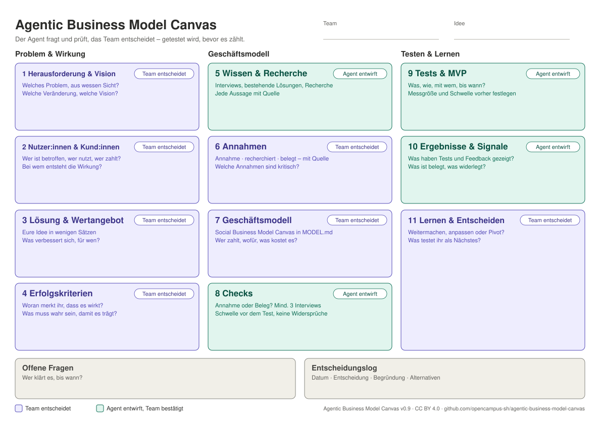

# Das Agentic Business Model Canvas

Eine Seite, elf Blöcke, ein Log. Beim ersten Mal füllt ihr es von links nach rechts; danach kehrt ihr zu jedem Block zurück, sobald sich etwas ändert. Es ordnet **Entscheidungen, Annahmen, Belege und Tests** rund um euer Geschäftsmodell. Das Social Business Model Canvas selbst liegt daneben in `MODEL.md`.

- Markdown-Vorlage für Projekte: [`CANVAS.md`](../skills/setup-model/templates/CANVAS.md) (wird von `/setup-model` in euren Projektordner kopiert)

**Owner.** 👤 *Team entscheidet*: Der Agent darf empfehlen, aber das Team trifft die Entscheidung. 🤖 *Agent entwirft, Team bestätigt*: Der Agent macht die Fleißarbeit; das Team prüft und übernimmt sie.

Dieselbe Grammatik wie die Canvases von [Agentic Data Science](https://github.com/steffen74/agentic-data-science) und [Agentic Course Creation](https://github.com/steffen74/agentic-course-creation):

| Data Science | Course Creation | Business Model | Gemeinsame Idee |
|---|---|---|---|
| 1 Decision | 1 Change | 1 Herausforderung & Vision | Was soll anders werden? |
| 3 Audiences | 2 Learners | 2 Nutzer:innen & Kund:innen | Für wen? |
| 2 Questions | 3 Learning goals | 3 Lösung & Wertangebot | Woran arbeiten wir? |
| 4 Success | 4 Evidence | 4 Erfolgskriterien | Vorab festlegen, was zählt |
| 5 Data | 5 Constraints | 5 Wissen & Recherche | Faktenbestand, Agentenarbeit |
| 6 Known in advance | 6 Assumed knowledge | 6 Annahmen | **Die Grenze** |
| 7 Data decisions | 7 Design decisions | 7 Geschäftsmodell | Abwägungen, geloggt |
| 8 Checks | 8 Checks | 8 Checks | Prüfungen, bevor etwas zählt |
| 9 Experiments | 9 Resources | 9 Tests & MVP | Was gebaut wurde |
| 10 Findings | 10 Learner signals | 10 Ergebnisse & Signale | Was es gezeigt hat |
| 11 Recommendation | 11 Improvements | 11 Lernen & Entscheiden | Schleife schließen |

---

## Problem & Wirkung

### 1. Herausforderung & Vision 👤
**Zweck:** das Startup am Problem verankern, nicht an der Lösung.
**Leitfragen:** Welches gesellschaftliche Problem, aus Sicht der Betroffenen? Ursachen (5 Whys) und Folgen, zusammengefasst im Problembaum (`PROBLEM.md`). Welche Veränderung wollt ihr bewirken? Vision in höchstens zwei Sätzen („Wir wollen, dass …“).
**Typische Fehler:** das Problem als fehlende Lösung beschreiben („es gibt keine App für …“); Symptome statt Ursachen; eine Vision, die ein Produkt beschreibt.
**Gefüllt von:** `/grill-problem` (Problem, Ursachen, Folgen), `/grill-solution` (Vision, Veränderung)

### 2. Nutzer:innen & Kund:innen 👤
**Zweck:** wissen, für wen ihr Wirkung schafft und wer dafür bezahlt.
**Leitfragen:** Wer ist betroffen? Wer nutzt die Lösung, wer bezahlt oder ermöglicht sie? Welcher Fall trifft zu: dieselben, verschieden, Zielgruppe in der Wertschöpfungskette, oder nichts davon (z. B. Umsatzspende)?
**Typische Fehler:** „die breite Masse“ als Zielgruppe; Nutzer:innen und Kund:innen gleichsetzen, obwohl eine dritte Partei zahlt.
**Gefüllt von:** `/grill-problem` (Betroffene), `/grill-solution` (Nutzer:innen, Kund:innen, Fall)

### 3. Lösung & Wertangebot 👤
**Zweck:** die Idee knapp beschreiben und sagen, was sie für wen verbessert.
**Leitfragen:** Lösung in wenigen Sätzen (Produkt oder Dienstleistung). Was verbessert sich für Nutzer:innen, was für Kund:innen? Passt das Angebot zu ihren Aufgaben, Schwierigkeiten und erhofften Gewinnen? Dafür nutzt ihr das [Value Proposition Canvas](https://www.strategyzer.com/library/value-proposition-canvas-a-tool-to-understand-what-customers-really-want) von Strategyzer.com.
**Typische Fehler:** eine Lösung, die schon feststand, bevor ihr mit Betroffenen gesprochen habt; ein Wertangebot nur für die Zahlenden.
**Gefüllt von:** `/grill-solution`

### 4. Erfolgskriterien 👤
**Zweck:** vorher festlegen, was zählt.
**Leitfragen:** Woran merkt ihr, dass das Problem kleiner wird? Was muss wahr sein, damit euer Modell trägt (z. B. genug Kund:innen zahlen genug)?
**Typische Fehler:** Kriterien erst nach dem Test festlegen; „die Leute fanden es gut“ als Erfolg.
**Gefüllt von:** `/grill-solution`, ergänzt von `/to-tests`

---

## Geschäftsmodell

### 5. Wissen & Recherche 🤖
**Zweck:** ein Faktenbestand mit Quellen.
**Leitfragen:** Welche Interviews habt ihr geführt und was kam heraus (`INTERVIEWS.md`)? Welche Lösungen gibt es schon, mit welchen Stärken und Schwächen (SWOT)? Welche Zahlen und Fakten aus Recherche, mit Link?
**Typische Fehler:** Recherche als Beleg für ein Bedürfnis werten; Aussagen ohne Quelle; Interviews, in denen ihr eure Idee pitcht.
**Gefüllt von:** `/to-interview-guide`, `/log-evidence`, `/map-solutions`

### 6. Annahmen 👤
**Zweck:** **die Grenze** zwischen dem, was ihr wisst, und dem, was ihr vermutet.
**Leitfragen:** Jede Aussage aus Canvas und Modell steht im Annahmen-Register (`ASSUMPTIONS.md`), mit Status – *Annahme* (vermutet), *recherchiert* (Quelle, aber kein Beleg für ein Bedürfnis) oder *belegt* (durch eure Interviews, Tests oder MVP) – und Quelle. Welche Annahmen sind kritisch, weil alles andere auf ihnen aufbaut?
**Typische Fehler:** ein Canvas, das fertig aussieht, aber nur Annahmen enthält; ein vom Agenten gefülltes Canvas für Wissen halten.
**Gefüllt von:** alle Skills schreiben ins Register; Status ändert nur `/log-evidence` mit dem Team; Regeln im Skill `assumptions`, geprüft von `check_project.py`

### 7. Geschäftsmodell 👤
**Zweck:** das Geschäftsmodell auf einen Blick, mit den Kernentscheidungen.
**Leitfragen:** Euer Social Business Model Canvas in `MODEL.md`: zehn Felder von der gesellschaftlichen Herausforderung bis zur Kostenstruktur. Hier im Canvas nur: Wer zahlt? Woher kommen die Einnahmen? Was sind die größten Kosten?
**Typische Fehler:** zu viele Details; ein Modell, in dem niemand zahlt; Felder, die einander widersprechen.
**Gefüllt von:** `/to-model`

### 8. Checks 🤖
**Zweck:** Prüfungen, die bestehen müssen, bevor eine Aussage zählt.
**Leitfragen:** Steht jede Aussage im Annahmen-Register? Sind mindestens drei Interviews ausgewertet? Hat jeder Test vorher eine Schwelle? Widersprechen sich Canvas und Modell nirgends?
**Typische Fehler:** das eigene Canvas noch einmal lesen und für geprüft halten.
**Gefüllt von:** `/setup-model` (Grundstand), `/review-model`, `/model-retro`; Katalog im Skill `evidence-checks`

---

## Testen & Lernen

### 9. Tests & MVP 🤖
**Zweck:** die kritischen Annahmen zuerst testen, schnell und billig.
**Leitfragen:** Pro kritischer Annahme eine Testkarte (`TESTS.md`): Was testet ihr, wie (MVP, Interview, Angebot gegen Geld), mit wem, bis wann, mit welcher Messgröße und welcher Schwelle? Mindestens zwei Personen oder Organisationen.
**Typische Fehler:** Umfragen statt echter Angebote (höfliche Antworten); ein MVP, das Monate dauert; Tests ohne Schwelle.
**Gefüllt von:** `/to-tests`; Ergebnisse trägt das Team ein

### 10. Ergebnisse & Signale 🤖
**Zweck:** festhalten, was Tests und Gespräche gezeigt haben.
**Leitfragen:** Was kam heraus, gemessen an der Schwelle? Was hat überrascht? Welche Annahmen sind jetzt belegt, welche widerlegt (`SIGNALS.md`)?
**Typische Fehler:** nur die Ergebnisse notieren, die passen; Ergebnisse nicht ins Annahmen-Register übertragen.
**Gefüllt von:** `/log-evidence`, `/review-model`

### 11. Lernen & Entscheiden 👤
**Zweck:** die Schleife schließen.
**Leitfragen:** Weitermachen, anpassen oder neu ansetzen (Pivot)? Was ändert sich im Canvas und im Modell? Was testet ihr als Nächstes?
**Typische Fehler:** an der Idee festhalten, obwohl die kritische Annahme widerlegt ist; Entscheidungen, die nur im Kopf stehen.
**Gefüllt von:** `/review-model`, `/model-retro`; das Team entscheidet

---

## Offene Fragen und Entscheidungslog

Offene Fragen nennen, wer sie klärt und bis wann. Entscheidungen stehen in `DECISIONS.md` mit Datum, Begründung, Alternativen und betroffenen Blöcken.

---

Das Canvas steht unter CC BY 4.0 (Campus Business Box e.V., opencampus.sh). Das Social Business Model Canvas in `MODEL.md` folgt dem Handout von SEEd / Campus Business Box e.V. nach dem Business Model Canvas von [Strategyzer.com](https://www.strategyzer.com) und steht unter CC BY-SA 4.0.
